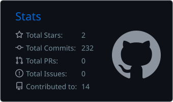
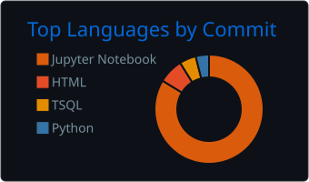

# 👋 Hi, I'm Davide Corbo

`Data Curator / Data Scientist`

I work where **data engineering, machine learning and AI agents** meet, turning messy, fragmented information into reliable data that people can act on.

I'm currently a **Data Curator at [Dealroom.co](https://dealroom.co)** in Lisbon, working on startup and venture capital intelligence. I build pipelines that source, match, clean, validate and load company, founder and funding data; design the rules, quality checks and review processes that let AI agents update data autonomously; and developed the **Unicorn Score** and **Exit Score**, ML predictive models that identify the startups most likely to become unicorns or reach successful exits.

I'm completing a **Postgraduate Degree in Enterprise Data Science & Analytics at NOVA IMS**, after a Bachelor's and a Master's degree in **Philosophical Sciences** (MA at the University of Bologna). 
Data science gave me the technical toolkit. Philosophy taught me to think rigorously about definitions, classification and evidence, which turns out to be at the heart of good data.

Interested in Machine Learning, Deep Learning, Neural Networks and AI Engineering.

---

## 🛠️ Languages & Tools

## 🚀 Featured Projects

| Project | Description |
|---|---|
| [Fantacalcio Mantra Auction Optimizer](https://github.com/iddadobroc/fantacalcio-mantra-auction-optimizer) | End-to-end decision-support system for the Fantacalcio auction: ML point projections, price modeling, combinatorial squad and formation optimization, Monte Carlo simulation and a live auction dashboard |
| [Diabetes Hospital Readmission](https://github.com/iddadobroc/Diabetes-Hospital-Readmission-Data-Science-Project) | Predicting 30-day readmission risk for diabetic patients (UCI "Diabetes 130-US hospitals") — NOVA IMS Data Science Bootcamp |
| [DSML Clustering](https://github.com/iddadobroc/DSML_Group11_Clustering) | Clustering project for the Data Science & Machine Learning course at NOVA IMS |
| [SpaceX Falcon 9 Analysis](https://github.com/iddadobroc/SpaceX-Falcon-9-Data-Science-Analysis) | Data science project on Falcon 9 launches (IBM Data Science capstone) |
| [Airbnb Price Prediction](https://github.com/iddadobroc/Airbnb_Price_Prediction) | Regression models for Airbnb listing prices |

## 🎓 Education & Certifications

- **PgD in Enterprise Data Science & Analytics** — NOVA IMS, Lisbon (2026–2027)
- **MA in Philosophical Sciences** — University of Bologna (2019–2022)
- **IBM Data Science Professional Certificate** — IBM (2025)

## ✍️ Writing

[*The Chessboard of Being. Between Necessity and Freedom, a Holistic Vision of the Universe*](https://www.researchgate.net/publication/388492588_The_Chessboard_of_Being_Between_Necessity_and_Freedom_a_Holistic_Vision_of_the_Universe) (2025): a philosophical essay using chess as a model for a universe that is both rule-bound and unpredictable.

## 📊 GitHub Stats

## 📫 Contacts

